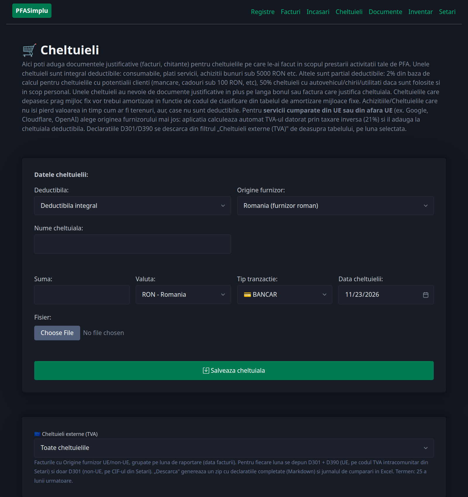
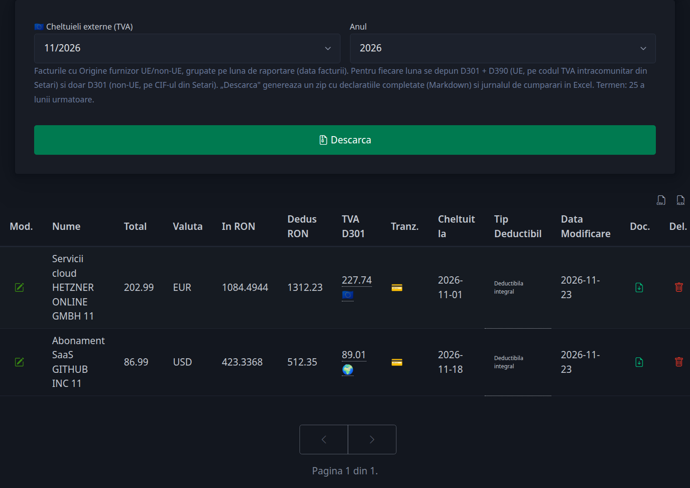
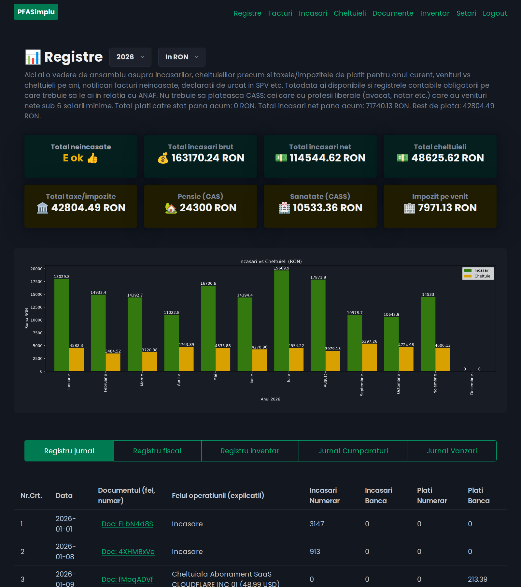

# PFASimplu


Aplicatie pentru simplificarea gestiunii contabilitatii facuta in partida simpla (versiunea 3).  

<!-- START doctoc generated TOC please keep comment here to allow auto update -->
<!-- DON'T EDIT THIS SECTION, INSTEAD RE-RUN doctoc TO UPDATE -->
**Table of Contents**  *generated with [DocToc](https://github.com/thlorenz/doctoc)*

- [Pentru cine este de folos aceasta aplicatie?](#pentru-cine-este-de-folos-aceasta-aplicatie)
- [Poate aplicatia sa faca X,Y,Z?](#poate-aplicatia-sa-faca-xyz)
- [Instalare pt. utilizatori](#instalare-pt-utilizatori)
- [Instalare pt. developeri](#instalare-pt-developeri)
- [Instalare pe VPS (Docker, mod multi-user)](#instalare-pe-vps-docker-mod-multi-user)
- [Ghid de utilizare: de la instalare la rutina zilnica](#ghid-de-utilizare-de-la-instalare-la-rutina-zilnica)
- [Setari](#setari)
- [Facturi](#facturi)
- [Incasari](#incasari)
- [Cheltuieli](#cheltuieli)
  - [Servicii cumparate din UE / non-UE (taxare inversa)](#servicii-cumparate-din-ue--non-ue-taxare-inversa)
- [Documente](#documente)
- [TVA intracomunitar: D301, D390 si Jurnal de cumparari](#tva-intracomunitar-d301-d390-si-jurnal-de-cumparari)
- [Inventar](#inventar)
- [Registre](#registre)
- [Actualizare aplicatie](#actualizare-aplicatie)
- [Debug si testare (dezvoltatori)](#debug-si-testare-dezvoltatori)
  - [Rulare locala pentru dezvoltare](#rulare-locala-pentru-dezvoltare)
  - [Structura codului](#structura-codului)
  - [Teste end-to-end](#teste-end-to-end)
  - [Depanare](#depanare)
- [Observatii](#observatii)

<!-- END doctoc generated TOC please keep comment here to allow auto update -->


## Pentru cine este de folos aceasta aplicatie?

- Pentru cei care detin PFA, PFI, II, etc si pot tine contabilitatea in partida simpla;
- Impozitare in sistem real (fara norma de venit);
- Nu au depasit pragul TVA (venituri sub 395k RON pe an);
- Sunt prestatori de servicii (freelanceri, instalatori, curieri glovo, tazz, soferi taxi, bold, uber etc.);

Aplicatia te ajuta sa:
- creezi facturi: e-factura (fara TVA), facturi PDF in mai multe limbi si valute;
- tii la curent toate registrele obligatorii pentru PFA (Registru Jurnal, Registru Fiscal, Registru Inventar);
- calculeaza automat cheltuielile deductibile partial si mijloacele fixe;
- arhivezi declaratiile depuse la ANAF;
- calculeaza automat taxele si impozitele datorate in functie de incasari/cheltuieli;
- calculeaza automat TVA-ul datorat pentru servicii cumparate din UE/non-UE (taxare inversa) si genereaza declaratiile D301/D390 + Jurnalul de cumparari, daca ai cod special de TVA intracomunitar (art. 317);


## Poate aplicatia sa faca X,Y,Z?

Aplicatia am facut-o potrivita pentru nevoile mele. Daca pe parcurs voi avea nevoie de X,Y,Z atunci poate voi actualiza aplicatia sa contina si X,Y,Z (cum am facut cu e-factura).

As fi vrut sa adaug mai multe functionalitati, dar nu am cunostinte solide de contabilitate. 
Daca deschizi un `New issue` din tabul `Issues` din aceasta pagina si spui pas cu pas care sunt cerintele voi lua in considerare sa adaug in aplicatie o noua functionalitate (in functie de timp si cunostinte).


## Instalare pt. utilizatori

Din sectiunea `Releases` din aceasta pagina descarca zip-ul pentru sistemul tau de operare. 
Odata descarcat click dreapta unzip si rulezi executabilul `pfasimplu.exe`.
Daca ai MacOS va trebui sa urmezi sectiunea *Instalare pt. developeri*. 

- [Click aici](https://github.com/ClimenteA/PFASimplu/releases) si descarca zip-ul din `Assets` pentru sistemul tau de operare (Windows, Ubuntu);

Daca executabilul nu functioneaza pe Windows va trebui sa instalezi [latest-microsoft-visual-c-redistributable-version x64 (click)](https://learn.microsoft.com/en-us/cpp/windows/latest-supported-vc-redist?view=msvc-170#latest-microsoft-visual-c-redistributable-version).

Executabilul nu are un certificat digital, asa ca sistemul de operare (windows/macos) iti va spune ca executabilul este un posibil virus sau ca este de la "un unknown publisher". Poti urma sectiunea *Instalare pt. developeri* daca vrei sa eviti asta. Sa fii safe: nu descarca acest executabil din alta locatie decat cea din acest GitHub repo!


## Instalare pt. developeri

Aplicatia este facuta in Python (>= 3.12), Django cu SQLiteDB. 

- clone repo;
- [instaleaza uv](https://docs.astral.sh/uv/getting-started/installation/) (managerul de pachete folosit de proiect);
- `uv sync` - creeaza `.venv` si instaleaza dependintele (inclusiv cele de testare);
- `make migrate-all` - creeaza/aplica migrarile pentru toate app-urile;
- `make dev` - porneste serverul de dezvoltare la `http://127.0.0.1:8990` (aka `uv run manage.py runserver 8990`);
- `make purge-db` - sterge `dbsqlite/stocare.db` (sqlite db) si toate folderele `migrations`;
- `make purge-migration-dirs` - sterge toate folderele `migrations`;
- `make package` - creeaza aplicatia pfasimplu ca executabil pentru sistemul de operare pe care a fost rulat;
- `make test-e2e` - ruleaza testele end-to-end (vezi sectiunea [Debug si testare (dezvoltatori)](#debug-si-testare-dezvoltatori)).

Pe Windows comenzile make au echivalentul `.\makefile.bat X` - unde X poate fi `run`, `migrate-all`, `purge-db`, `purge-migration-dirs` etc. (ex: `.\makefile.bat run` porneste `python manage.py runserver` pe portul implicit 8000).

- activate venv windows - `& D:/PFASimplu/.venv/Scripts/Activate.ps1`
- allow bash in powershell - `Set-ExecutionPolicy Unrestricted -Scope Process`

Datele aplicatiei stau local: baza de date in `dbsqlite/stocare.db`, fisierele urcate/generate in `media/`. Ambele sunt in `.gitignore` - nu se urca in git. Poti muta locatia lor cu variabilele de mediu `PFASIMPLU_DB_PATH` si `PFASIMPLU_MEDIA_ROOT` (util ca sa lucrezi/testezi fara sa atingi datele reale).


## Instalare pe VPS (Docker, mod multi-user)

Aplicatia poate rula si pe un server, cu **login/inregistrare pe email + parola**
(sistemul de autentificare inclus in Django) si **date izolate per utilizator**:
fiecare cont isi vede doar propriile incasari, cheltuieli, facturi, documente si
setari, iar fisierele urcate stau in `media/user_<id>/` si pot fi descarcate doar
de proprietar.

Modul multi-user se activeaza prin `PFASIMPLU_MULTI_USER=1` (setat automat in
Docker). **Implicit aplicatia desktop ramane fara login**, exact ca pana acum -
nu trebuie schimbat nimic la instalarea locala.

Pe VPS (cu Docker si Docker Compose instalate):

```bash
git clone https://github.com/ClimenteA/PFASimplu && cd PFASimplu

# configurarea aplicatiei
cp .env.prod.example .env.prod
# editeaza .env.prod: PFASIMPLU_SECRET_KEY (aleator, lung),
# PFASIMPLU_ALLOWED_HOSTS si PFASIMPLU_CSRF_TRUSTED_ORIGINS cu domeniul tau

# aplicatia + proxy-ul TLS (Caddy); pune domeniul tau in Caddyfile
docker compose up -d --build   # sau: make start
```

- Baza de date SQLite si fisierele urcate raman pe gazda in `./data/`
  (volume in `docker-compose.yml`) - poti face backup doar la acest folder.
- La pornire containerul aplica migrarile si colectorul de fisiere statice automat.
- Optional: seteaza `DJANGO_SUPERUSER_EMAIL` / `DJANGO_SUPERUSER_PASSWORD` in
  `.env.prod` pentru a crea un cont de admin (`/admin/`) la prima pornire.
- Optional: `PFASIMPLU_ALLOW_REGISTRATION=0` in `.env.prod` blocheaza crearea de
  conturi noi (pagina de inregistrare devine 404); utilizatorii existenti se pot
  autentifica in continuare. Util implicit: `1` (inregistrare deschisa).
- Pentru test local fara domeniu/TLS: in Caddyfile inlocuieste domeniul cu `:80`
  si in `.env.prod` pune `PFASIMPLU_ALLOWED_HOSTS=localhost` si
  `PFASIMPLU_CSRF_TRUSTED_ORIGINS=http://localhost`.

Pentru a rula varianta dockerizata local, mereu pornita (fara Caddy/TLS):

```bash
docker compose -f docker-compose-local.yml up -d --build   # sau: make start-local
```

Aplicatia e accesibila la `http://localhost:8996`. Portul se schimba prin
`PFASIMPLU_PORT` (ex. `PFASIMPLU_PORT=9000 docker compose -f docker-compose-local.yml up -d`).
Cu `restart: unless-stopped` si serviciul Docker pornit la boot, aplicatia revine
singura dupa restartul calculatorului (mai putin daca a fost oprita manual).

Pentru a rula modul multi-user si fara Docker (ex. pentru teste):

```bash
PFASIMPLU_MULTI_USER=1 uv run manage.py runserver
```


## Ghid de utilizare: de la instalare la rutina zilnica

Ordinea conteaza: aplicatia foloseste datele din `Setari` in toate celelalte pagini (antetul facturilor, IBAN-ul in moneda facturii, calculele de taxe, IBAN-ul trezoreriei pentru TVA).

**1. Prima deschidere - completeaza Setari**

Deschide aplicatia (executabilul descarcat, sau `make dev` → `http://127.0.0.1:8990`) si mergi intai in pagina `Setari`: numele PFA-ului, CIF, adresa, localitatea (aleasa din sugestii), conturile IBAN (unul per moneda: RON, EUR etc.), codul CAEN. Bifeaza scutirile doar daca ai statut special (pensionar, persoana cu handicap etc.). Daca ai cod special de TVA intracomunitar (art. 317), deschide sectiunea `TVA intracomunitar (D301/D390)` si completeaza codul - IBAN-ul trezoreriei se completeaza automat la alegerea localitatii. Salveaza. Fara acest pas, facturile nu au datele emitentului corecte.

**2. Emite prima factura (pagina Facturi)**

Completeaza clientul, seria si numarul (propuse automat: prima factura primeste seria `INV` si numarul `1`, apoi se continua seria existenta cu numarul urmator - poti schimba seria), articolele (denumire, UM, cantitate, pret), tipul facturii (e-factura pentru B2B in Romania, sau PDF in alta limba/valuta pentru extern). La salvare aplicatia genereaza automat PDF-ul facturii (si XML-ul UBL pentru e-factura) si le salveaza cu un prefix-id de 8 caractere. Le descarci din coloanele XML/PDF ale tabelului.

**3. Inregistreaza incasarea (pagina Incasari)**

Cand intra banii: din pagina `Facturi`, click pe 💳 (`Incasata`) in dreptul facturii - formularul de incasare se completeaza automat (suma, valuta, client), iar PDF-ul facturii devine document justificativ atasat incasarii. Pentru incasari fara factura emisa in aplicatie, completezi formularul din `Incasari` si urci documentul justificativ (extras de cont, chitanta; mai multe documente → un zip). Conversia in RON se face automat la cursul BNR din ultima zi bancara inaintea datei incasarii.

**4. Inregistreaza cheltuielile (pagina Cheltuieli)**

De fiecare data cand cumperi ceva pentru activitatea PFA-ului: urci factura/bonul, alegi deductibilitatea (integral, partial 50%/2%, mijloc fix cu amortizare, obiect de inventar), iar pentru servicii din UE/non-UE alegi originea furnizorului - TVA-ul prin taxare inversa se calculeaza singur. Obiectele de inventar si mijloacele fixe apar automat in pagina [Inventar](#inventar) cu numar de inventar; pentru mijloacele fixe se genereaza fisa de mijloc fix (PDF), iar amortizarea lunara apare in Registrul fiscal.

**5. Arhiveaza relatia cu ANAF (pagina Documente)**

Dupa ce depui Declaratia Unica (D212) sau platesti taxele, urci aici recipisa/dovada platii - datele relevante (an, sume, index) se extrag automat din PDF. La fel pentru recipisele D301/D390.

**6. Verifica situatia (pagina Registre)**

Oricand, dar musai inainte de a completa Declaratia Unica: cardurile cu totaluri si taxele estimate (CAS, CASS, impozit), graficul pe luni si registrele obligatorii (jurnal, fiscal, inventar, jurnal de cumparari). Sumele se pot vedea in RON sau EUR, pe orice an.

**7. Lunar, daca ai cod TVA intracomunitar:** filtreaza `Cheltuieli externe (TVA)` in pagina Cheltuieli pe luna trecuta, descarca zip-ul cu D301/D390 completate, depune-le pana pe 25, incarca recipisele in Documente si plateste TVA-ul la trezorerie (detalii in [TVA intracomunitar](#tva-intracomunitar-d301-d390-si-jurnal-de-cumparari)).

**8. La final de an:** din `Setari` → `Exporta datele din aplicatie` alegi anul si primesti un zip cu toate documentele justificative, registrele in Excel, fisele mijloacelor fixe si `SUMAR.html` - arhiva completa pentru acel an, de pastrat pentru controlul ANAF.

**Ce face aplicatia in spate cu fisierele:**
- fiecare fisier urcat sau generat (facturi PDF/XML, justificative, fise mijloc fix) e salvat in `media/` cu un prefix-id unic de 8 caractere (ex. `0x4rf2KW_factura_PFT-1.pdf`), ca sa nu existe coliziuni de nume; la re-incarcarea unui fisier deja prefixat, prefixul vechi e inlocuit;
- in modul multi-user fisierele stau in `media/user_<id>/` si pot fi descarcate doar de proprietar;
- exporturile CSV/XLSX ale registrelor si zip-urile generate (D301/D390, exportul pe an) se construiesc temporar in `media/extracts/` si se livreaza la download;
- la stergerea unei inregistrari din aplicatie, fisierul atasat ei este sters automat de pe disc (django-cleanup); `Sterge toate datele` din Setari sterge si baza de date si fisierele;
- cursurile BNR se iau online prin `cursvalutarbnr` si se cache-uiesc local, deci anii trecuti functioneaza si offline.


## Setari 

In pagina `Setari` trebuie sa adaugi datele pfa-ului tau.
Poti sterge toate datele.
Aceasta pagina trebuie completata la prima deschidere a aplicatiei.
Cam rar vei schimba datele din aceasta pagina.
Poti adauga mai multe conturi IBAN (RON, EUR, USD etc.), cate unul pentru fiecare moneda. La emiterea unei facturi se foloseste automat contul IBAN in moneda facturii, iar daca nu exista un cont in acea moneda, se foloseste contul de RON.

Cu butonul `Exporta datele din aplicatie` descarci un zip cu datele pentru **anul selectat** (ca sa nu se blocheze aplicatia procesand toti anii odata). Zip-ul contine:
- `documente/`, `cheltuieli/`, `incasari/` - documentele justificative urcate in aplicatie pentru anul selectat;
- registrele anului in format `.xlsx`: Registrul Jurnal, Registrul Inventar, Registrul Fiscal si Jurnalul de cumparari;
- `fise_mijloace_fixe/` - fisele mijloacelor fixe (PDF);
- `SUMAR.html` - metricile anului, in acelasi stil ca aplicatia (se deschide in orice browser): total incasari/cheltuieli, venit net, taxe si impozite de platit (CAS, CASS, impozit), ultima serie si numar de factura emisa (in anul exportat si in aplicatie), medii lunare, cea mai mare incasare/cheltuiala, incasari pe surse, cheltuieli pe deductibilitate si tabelele de amortizare per mijloc fix pana la amortizarea completa.


Daca ai **cod special de TVA intracomunitar (art. 317 Cod fiscal)** si cumperi servicii din UE/non-UE (ex. Google, Cloudflare, OpenAI), deschide sectiunea `TVA intracomunitar (D301/D390)` si completeaza:
- **Cod TVA intracomunitar** - codul special din certificatul de inregistrare in scopuri de TVA, fara prefixul RO. Este diferit de CIF-ul normal al PFA-ului: pentru facturi din UE se foloseste codul special, pentru non-UE codul normal (aplicatia alege automat codul corect);
- **IBAN trezorerie pentru plata TVA** - se completeaza **automat cand selectezi localitatea** (campul `Alege localitatea`): aplicatia are tabelul IBAN-urilor extras din [sursele oficiale ANAF](https://www.anaf.ro/anaf/internet/ANAF/asistenta_contribuabili/plata_oblig_fiscale/coduri_iban) (202 trezorerii operative, inclusiv sectoarele Bucurestiului) si stie contul `20A100101 - TVA incasata pentru operatiuni interne` pentru localitatea ta. Linkul PDF-ului ANAF ramane afisat ca sa poti verifica. Daca tabelul `static/iban_trezorerie.json` lipseste, aplicatia il descarca automat de pe ANAF la prima salvare a Setarilor (necesita conexiune la internet; dureaza cateva minute). Daca localitatea nu are trezorerie operativa proprie (sate/comune), cauta IBAN-ul in lista ANAF pentru judetul tau si completeaza-l manual. TVA-ul din D301 NU se plateste in contul unic.


## Facturi

In pagina `Facturi` poti crea facturi pentru clienti din afara tarii, precum si e-factura pentru B2B in Romania. 
Factura generata aici este valabila pentru **PFA-urile neplatitore de TVA**.
Odata ce datele sunt completate in formular ele vor putea fi folosite si pentru facturi viitoare.
Pentru e-factura valoarea din campul 'Alege localitatea' trebuie sa fie una din valorile sugerate pe masura ce tastezi.
Fisierul generat XML este conform [XML-UBL versiunea 1.0.3](https://www.anaf.ro/CompletareFacturaSimplificat/faces/factura/informatiigenerale.xhtml).
Validarea fisierului XML a fost facuta pentru standard [FACT1](https://www.anaf.ro/uploadxmi/).
Poti prelua date CUI firma [de aici.](https://mfinante.gov.ro/apps/agenticod.html?pagina=domenii).

Campurile: Serie, Numar factura vor fi completate automat in functie de facturile din trecut. 
Seria + numarul facturii sunt verificate sa fie unice in baza de date.
Pe masura ce completezi campul Nume Client vor aparea sugestii de clienti existenti - 
cu un click poti selecta clientul si formularul va fi completat automat.
In campul Tip factura poti alege sa generezi factura in alta limba (non e-factura). 
Poti schimba si valuta in care emiti factura.

Din coloanele XML si PDF poti descarca facturile generate. In dreapta sus a tabelului sunt 2 butoane pentru a descarca toate facturile in format CSV sau XLSX. In coloana Del. poti sterge o factura.

Din coloana **Incasata** (butonul 💳) treci direct la pagina [Incasari](#incasari) cu formularul precompletat din factura respectiva (suma, valuta, client), iar PDF-ul facturii este atasat automat ca document justificativ al incasarii.

Optional: Daca dai click pe Mai mult vei putea completa si alte date alte clientului precum:
Nr.Registru Comertului, Telefon, Email, Data Emitere factura (completata automat pentru ziua curenta), Data scadenta (calculata automat la 30 in viitor fata de ziua curenta) si Nota (unde poti adauga niste mentiuni in factura).


## Incasari

Aici poti aduga documentele justificative (facturi, chitante) prin care ai incasat bani oferind produse sau servicii cu PFA-ul tau. Daca ai incasari din alte surse decat din emitere facturi/bonuri selecteaza o alta sursa a venitului. In cazul incasarilor in alta moneda decat RON conversia va fi facuta automat la cursul zilei anterioare setata in campul 'Data incasarii'. Completeaza 'Data incasare' doar daca ai incasat banii, lasa campul gol daca nu ai incasat inca (vei putea modifica mai tarziu). Sumele incasate in alta valuta (EUR,USD etc) - sumele sunt convertite in RON in functie de 'Data incasare'.

Cu un click intr-o celula din coloana Mod. poti modifica o incasare. Din coloana Doc. poti descarca o incasare si in coloana Del. poti sterge o incasare. Daca trebuie sa adaugi mai mult de un document poti crea un zip cu toate documentele necesare.


## Cheltuieli

Aici poti aduga documentele justificative (facturi, chitante) pentru cheltuielile pe care le-ai facut in scopul prestarii activitatii tale de PFA. Unele cheltuieli sunt integral deductibile: consumabile, plati servicii, achizitii bunuri sub 5000 RON etc. Altele sunt partial deductibile: 2% din baza de calcul pentru cheltuielile cu potentialii clienti (mancare, cadouri sub 100 RON, etc), 50% cheltuieli cu autovehicul/chirii/utilitati daca sunt folosite si in scop personal. Unele cheltuieli au nevoie de documente justificative in plus pe langa bonul sau factura care justifica cheltuiala. Cheltuielile care depasesc prag mijloc fix vor trebui amortizate in functie de codul de clasificare din tabelul de amortizare mijloace fixe. Achizitiile/Cheltuielile care nu isi pierd valoarea in timp cum ar fi terenuri, aur, case nu sunt deductibile. Daca trebuie sa adaugi mai mult de un document poti crea un zip cu toate documentele necesare.

Campul Deductibila contine si cheltuielile deductibile partial care vor fi calculate automat in functie de datele existente in aplicatie.



Atunci cand ai de adaugat un obiect de inventar cu valoarea peste 5000 RON trebuie sa selectezi `Mijloc fix peste 5000 RON (ded. integral cu amortizare)`. In campul nume cheltuiala poti vedea valorile pentru mijloace fixe. Campul Nume cheltuiala poate fi folosit pentru a filtra tipul cheltuielii.

Uite un exemplu pentru a amortiza o cheltuiala amortizabila cu un Laptop. 
Cel mai apropiat de un laptop in tabel este valoarea `Calculatoare electronice` care are codul `2.2.9.` 
si o perioada de amortizare intre 2 si 4 ani. 


> Amortizare: 2-4 ani. COD: '2.2.9.' din GRUPA 2. INSTALATII TEHNICE, MIJLOACE DE TRANSPORT, ANIMALE SI PLANTATII - 2.2. APARATE SI INSTALATII DE MASURARE, CONTROL SI REGLARE.. Active fixe: Calculatoare electronice si echipamente periferice. Masini si aparate de casa, control si facturat.

Odata introduse aceste date, aplicatia va calcula automat amortizarea acelui activ fix.


### Servicii cumparate din UE / non-UE (taxare inversa)

Daca ai cod special de TVA intracomunitar (art. 317) si cumperi servicii de la furnizori din afara Romaniei (ex. Google, Cloudflare, OpenAI, Cortecs), la adaugarea cheltuielii alege la **Origine furnizor** `Servicii din UE` sau `Servicii din afara UE`. Apare o sectiune suplimentara cu datele de pe factura furnizorului (care are de obicei mentiunea *reverse charge / 0% VAT*):

- **Denumire furnizor** - pe masura ce tastezi apar sugestii din facturile anterioare; cu un click codul TVA si tara se precompleteaza automat;
- **Tara furnizor** - lista este filtrata dupa originea aleasa: `Servicii din UE` arata doar cele 27 de state membre UE ([sursa oficiala](https://european-union.europa.eu/node/288/rss_ro)), `Servicii din afara UE` doar tarile non-UE (Marea Britanie este non-UE dupa Brexit); UE/non-UE se deduce automat din tara, iar daca ai ales gresit tipul, aplicatia il corecteaza;
- **Cod TVA / cod fiscal furnizor** - pentru UE codul TVA complet cu prefixul tarii (ex. `ATU77164426`), pentru non-UE codul fiscal strain (ex. EIN `27-0805829`), daca exista;
- **Numar factura** si **Data facturii** (exigibilitatea TVA) - daca data facturii lipseste se foloseste data cheltuielii.

**Calculele se fac automat la salvare**, nu trebuie sa completezi nimic manual:
- cursul BNR din data exigibilitatii (data facturii), luat automat din `cursvalutarbnr`;
- baza in lei = valoarea in valuta x curs;
- TVA autolichidata = baza x 21% (cota standard);
- TVA-ul se adauga automat la cheltuiala deductibila (este o cheltuiala a PFA-ului, platita la ANAF prin D301) - vezi coloana `TVA D301` din tabel, cu badge 🇪🇺 (UE) sau 🌍 (non-UE).

Odata salvata, cheltuiala apare automat in **Jurnalul de cumparari (TVA)** din pagina [Registre](#registre) (tab `Jurnal Cumparaturi`) - este generat din calcul, nu trebuie inserat nimic. Declaratiile D301/D390 se descarca din filtrul „Cheltuieli externe (TVA)" de deasupra tabelului - vezi sectiunea [TVA intracomunitar](#tva-intracomunitar-d301-d390-si-jurnal-de-cumparari).


## Documente

Aici poti introduce documentele create in relatia cu ANAF. Declaratii, dovezi plati taxe si impozite si alte documente pe care le consideri importante. Daca nu ai depasit plafonul TVA de 395000 RON pe an si nu ai angajati (poti avea 3 angajati) singura declaratie pe care trebuie sa o completezi este Declaratia Unica 212. Daca ai depasit plafonul TVA sau ai angajati poate un SRL ar fi mai potrivit. Daca nu gasesti tipul declaratiei alege 'Document util' si completeaza in campul 'Mentiuni' detalii despre documentul incarcat.

In cazul dovezii platii de impozite (pdf-ul primit de la ghiseul.ro) si al declaratiei unice datele relevante sunt automat extrase din PDF-ul incarcat.

Recipisele D301/D390 primite de la ANAF se incarca tot aici - tipul declaratiei, perioada, CIF-ul si indexul de incarcare se detecteaza automat din PDF. Declaratiile in sine se genereaza din pagina [Cheltuieli](#tva-intracomunitar-d301-d390-si-jurnal-de-cumparari).


## TVA intracomunitar: D301, D390 si Jurnal de cumparari

Pentru PFA-urile cu **cod special de TVA intracomunitar (art. 317 Cod fiscal)** care cumpara servicii din UE sau din afara UE, TVA-ul se datoreaza in Romania prin **taxare inversa**: chiar daca furnizorul factureaza 0% TVA, beneficiarul calculeaza si plateste 21% la ANAF. Aplicatia automatizeaza tot fluxul:

**Ce se depune:**

| Situația | D301 | D390 VIES | Codul folosit |
|---|---|---|---|
| Furnizor din UE (Austria, Irlanda, Germania etc.) | Da - secțiunea 4 + secțiunea 4.1 | Da - tip S | Codul special de TVA intracomunitar |
| Furnizor din afara UE (SUA, UK, Canada etc.) | Da - doar secțiunea 4 | Nu | Codul normal al PFA-ului (CIF) |

**Fluxul in aplicatie (pagina Cheltuieli, filtrul „Cheltuieli externe (TVA)"):**

1. **Adaugi cheltuielile** cu origine UE/non-UE (vezi [Cheltuieli](#cheltuieli)) - cursul BNR, baza si TVA-ul se calculeaza automat;
2. **Filtrezi pe luna** - din selectorul „Cheltuieli externe (TVA)" de deasupra tabelului alegi luna de raportare (lunile cu facturi UE/non-UE, grupate dupa data facturii); tabelul arata doar facturile pentru care trebuie completate declaratiile;
3. **Descarci** - un click pe butonul `Descarca` si primesti un zip cu declaratiile completate in **Markdown**, **grupate in cate un folder pentru fiecare cod fiscal**, cu prefix dupa tipul codului:
   - **`TVA-<cod>`** (codul special de TVA intracomunitar, art. 317): **D301** (sectiunile 4 + 4.1) + **D390 VIES** (tip S, cod operator fara prefixul tarii, baza rotunjita la intreg) + jurnalul de cumparari in **Excel** doar cu facturile UE + **facturile furnizorilor** (subfolder `facturi/`);
   - **`CIF-<cod>`** (codul normal al PFA-ului): **D301** (doar sectiunea 4) + jurnalul de cumparari in **Excel** doar cu facturile non-UE + **facturile furnizorilor** (subfolder `facturi/`);
   - fiecare D301 contine antetul, sectiunile cu toate valorile, termenul si **instructiunea de plata** (IBAN trezorerie, cod bugetar `20A100101`, suma, CIF platitor);
   - jurnalul de cumparari pe toata luna este disponibil si separat in [Registre](#registre) > `Jurnal Cumparaturi` (CSV/XLSX), cu referinta `15-16`;
4. **Depui** declaratiile online: ai nevoie de un **cont SPV inregistrat pe codul de TVA intracomunitar** (pe acel cont te loghezi si preiei recipisele). Intră pe [e-guvernare.ro](https://www.e-guvernare.ro/) → click pe **DEPUNERE DECLARATII ANAF** (redirecționează către [decl.anaf.mfinante.gov.ro](https://decl.anaf.mfinante.gov.ro/my.policy)) → **Authentificare cu certificat** (certificat digital calificat de la certDigital, DigiSign etc.) → completezi PDF-ul inteligent cu valorile din fisierele Markdown, îl validezi și semnezi (suma de control si nr. de evidenta a platii se genereaza de aplicatia oficiala ANAF la validare), îl urci, apoi te loghezi în SPV-ul pe codul TVA, descarci recipisa și verifici să fie fără erori de încărcare; termen: **25 inclusiv a lunii urmatoare**;
5. **Incarci recipisa** in pagina [Documente](#documente) - tipul (D301/D390), perioada, CIF-ul si indexul de incarcare se detecteaza automat din PDF;
6. **Platesti** TVA-ul in contul trezoreriei din Setari (instructiunea de plata din fisierul D301 are toate datele).

Daca lipsesc date din Setari (cod TVA intracomunitar, IBAN trezorerie) apar avertizari la descarcare.



**Jurnalul de cumparari** este disponibil si in pagina [Registre](#registre) (tab `Jurnal Cumparaturi`), cu descarcare CSV/XLSX pe luna sau pe tot anul. Totalul documentului include TVA autolichidata, chiar daca furnizorul a facturat 0% TVA.

> **Atentie:** codul TVA intracomunitar (art. 317) nu confera calitatea de platitor normal de TVA (art. 316). Aceasta functionalitate acopera regimul art. 317 (D301/D390), nu decontul D300. Pentru situatii speciale confirma tratamentul cu contabilul.


## Inventar

Aici gasesti tabelul cu toate obiectele de inventar si mijloacele/activele fixe achizitionate pana acum. Tot aici poti scoate din inventar un obiect de inventar sau mijloc fix. Daca ai vandut obiectul de inventar/mijlocul fix va trebui sa-l introduci si la incasari la Sursa venit: 'Venit din alte surse'. 

Pentru a scoate un obiect de inventar din uz trebuie sa dai click in coloana Mod. pe iconita de modificare. 
Formularul va fi completat cu datele salvate anterior pe care acum le poti modifica si salva (bifezi „Scoate din uz").

Registrul-inventar se descarca din pagina [Registre](#registre) (tab `Registru inventar`, iconitele CSV/XLSX), direct ca fisier CSV sau XLSX.


## Registre

Aici ai o vedere de ansamblu asupra incasarilor, cheltuielilor precum si taxele/impozitele de platit pentru anul selectat, venituri vs cheltuieli pe ani, notificari facturi neincasate, declaratii de urcat in SPV etc. Totodata ai disponibile si registrele contabile obligatorii pe care trebuie sa le ai in relatia cu ANAF, in tab-urile: `Registru jurnal`, `Registru fiscal`, `Registru inventar` si `Jurnal Cumparaturi`.

Poti alege anul si sa vezi sumele din grafic si total carduri in EUR sau RON.

Taxele se calculeaza pe regulile din anul selectat (vezi `utils/calcule.py`): din 2025, daca venitul net este 0 sau negativ nu datorezi CASS; pentru venit net pozitiv CASS este 10% din venitul net, cu o baza minima de 6 salarii minime brute si o baza maxima de 60 de salarii (72 din 2026). CAS (25%) se datoreaza doar peste pragul de 12 salarii minime, iar impozitul pe venit (10%) se aplica la venitul net din care se scad CAS si CASS. Cei scutiti (profesii liberale cu casa de asigurari proprie, pensionari etc.) pot bifa scutirile in [Setari](#setari).

Poti descarca registrele dand click fie pe iconita de csv sau xlsx. Se descarca direct un singur fisier CSV sau XLSX cu datele registrului, fara arhiva zip si fara documentele justificative. Toate fisierele salvate in aplicatie vor avea un prefix id de 8 caractere dupa care le puteti gasi (ex: `0x4rf2KW_Factura_etc.pdf`).  

In tab-ul **Jurnal Cumparaturi** gasesti **Jurnalul de cumpărări**: daca ai cheltuieli cu servicii din UE/non-UE (taxare inversa), jurnalul pentru cumparari cu referinta `15-16`, baza impozitabila, TVA autolichidata si totalurile, descarcabil in CSV sau XLSX (pe luna sau pe tot anul).





## Actualizare aplicatie

Poti verifica oricand daca a aparut o versiune noua a aplicatiei pe pagina de [Github Releases](https://github.com/ClimenteA/PFASimplu/releases) (pagina de unde ai descarcat prima data aplicatia). Din Assets descarca ultima versiune pentru sistemul tau de operare.

Versiunea pe care o rulezi apare in subsolul paginii `Setari` (ex. `PFASimplu V3.0.0`). La actualizare, datele tale raman pe loc (baza de date `dbsqlite/stocare.db` si folderul `media/` nu sunt atinse de executabil); inlocuiesti doar executabilul/fisierele aplicatiei. Pentru siguranta, inainte de actualizare poti face un export pe an din `Setari` → `Exporta datele din aplicatie`.


## Debug si testare (dezvoltatori)

### Rulare locala pentru dezvoltare

```bash
uv sync                 # dependinte (inclusiv grupul dev: pytest, playwright, faker)
make migrate-all        # migrarile tuturor app-urilor
make dev                # http://127.0.0.1:8990, cu auto-reload la modificari de cod
```

Implicit `DEBUG=1` (vezi `core/settings.py`), deci erorile Django se afiseaza complet in browser, iar `django-browser-reload` reincarca pagina la modificari de template-uri/cod. Pentru a lucra fara sa atingi datele reale:

```bash
PFASIMPLU_DB_PATH=/tmp/demo.db PFASIMPLU_MEDIA_ROOT=/tmp/demo-media uv run manage.py runserver 8990
```

Alte variabile de mediu utile (toate in `core/settings.py`):

| Variabila | Rol | Implicit |
|---|---|---|
| `PFASIMPLU_DB_PATH` / `PFASIMPLU_DB_DIR` | locatia bazei de date SQLite | `dbsqlite/stocare.db` |
| `PFASIMPLU_MEDIA_ROOT` | folderul fisierelor urcate/generate | `media/` |
| `PFASIMPLU_MULTI_USER` | `1` = login pe email + parola, date izolate per user | `0` (desktop, fara login) |
| `PFASIMPLU_DEBUG` | `0` = mod productie (fara trace-uri in browser) | `1` |
| `PFASIMPLU_ALLOW_REGISTRATION` | `0` = blocheaza crearea de conturi (mod multi-user) | `1` |
| `PFASIMPLU_SECRET_KEY`, `PFASIMPLU_ALLOWED_HOSTS`, `PFASIMPLU_CSRF_TRUSTED_ORIGINS` | necesare pe server (vezi `.env.prod.example`) | - |

Modul multi-user local (pentru a testa login-ul si izolarea datelor):

```bash
PFASIMPLU_MULTI_USER=1 uv run manage.py runserver
# creeaza un cont din /conturi/inregistrare/ sau un admin:
uv run manage.py createsuperuser   # apoi /admin/
```

### Structura codului

| App / folder | Rol |
|---|---|
| `setari/` | datele PFA-ului, IBAN-uri, cod TVA intracomunitar, export/stergere date |
| `facturi/` | emitere facturi: PDF multi-limba + XML e-factura (UBL) |
| `incasari/` | incasari + documente justificative, conversie BNR |
| `cheltuieli/` | cheltuieli, deductibilitate, amortizare, taxare inversa TVA |
| `documente/` | arhiva ANAF (D212, dovezi plata, recipise D301/D390) cu parsing PDF |
| `inventar/` | obiecte de inventar si mijloace fixe |
| `registre/` | dashboard + registrele contabile, exporturi CSV/XLSX |
| `conturi/` | login/inregistrare/logout (doar mod multi-user) |
| `utils/` | calcule taxe (`calcule.py`), TVA (`tva.py`, `tva_documente.py`), curs BNR (`valuta.py`), fisiere (`files.py`), PDF-uri (`mijloc_fix_pdf.py`) |
| `templates/` + `static/` | UI: PicoCSS + Alpine.js, typeahead; fara build step de frontend |
| `tests/` | teste end-to-end Playwright (vezi mai jos) |

### Teste end-to-end

Testele ruleaza un scenariu complet pe anul curent (Setari → Facturi → Incasari → Cheltuieli, inclusiv taxare inversa si mijloace fixe) intr-un browser real, pe o **bază de date izolata** (`tests/.runtime/test.db`) - datele reale nu sunt atinse. Detalii in [tests/README.md](tests/README.md).

```bash
make test-e2e           # instaleaza Chromium (daca lipseste) + ruleaza toate testele

# echivalent, cu optiuni:
uv run playwright install chromium          # o singura data
uv run pytest tests/ -v                     # headless
uv run pytest tests/ -v --headed --slowmo 300   # cu browser vizibil
uv run pytest tests/ -v -k "luna3"          # doar o luna / o etapa
```

Dupa rulare, baza de date de test ramane in `tests/.runtime/` pentru inspectie manuala (o poti deschide cu orice client SQLite sau porni aplicatia pe ea cu `PFASIMPLU_DB_PATH`).

### Depanare

- **Serverul nu porneste / port ocupat**: `make dev` foloseste portul 8990; schimba-l cu `uv run manage.py runserver <port>`.
- **Erori de migrari dupa modificari de modele**: `make migrate-all`; daca migrarile sunt corupte, `make purge-migration-dirs` apoi `make migrate-all` (atenție: pe o baza de date existenta cu schema veche poate fi nevoie de `make purge-db`, care **sterge datele**).
- **Curs BNR indisponibil**: `cursvalutarbnr` ia cursurile online si le cache-uieste in folderul temporar al sistemului (`cache_cursvalutarbnr`); prima rulare necesita internet.
- **Fisiere lipsa dupa mutarea bazei de date**: fisierele sunt referite relativ la `PFASIMPLU_MEDIA_ROOT` - muta si folderul `media/` odata cu `stocare.db`.
- **Login obligatoriu fara sa vrei**: verifica sa nu ai `PFASIMPLU_MULTI_USER=1` in mediu.


## Observatii

**Aplicatia este oferita ca atare, nu are nici o garantie asociata**. Nu imi asumam raspunderea pentru eventuale erori in procesare date contabilitate, daune provocate dispozitivelor etc. Testeaza aplicatia inainte si vezi daca raspunde nevoilor tale inainte de o adauga in rutina de lucru.

Daca gasesti erori in aplicatie poti deschide un [`New issue`](https://github.com/ClimenteA/PFASimplu/issues/new) in tabul `Issues` din acesta pagina.
